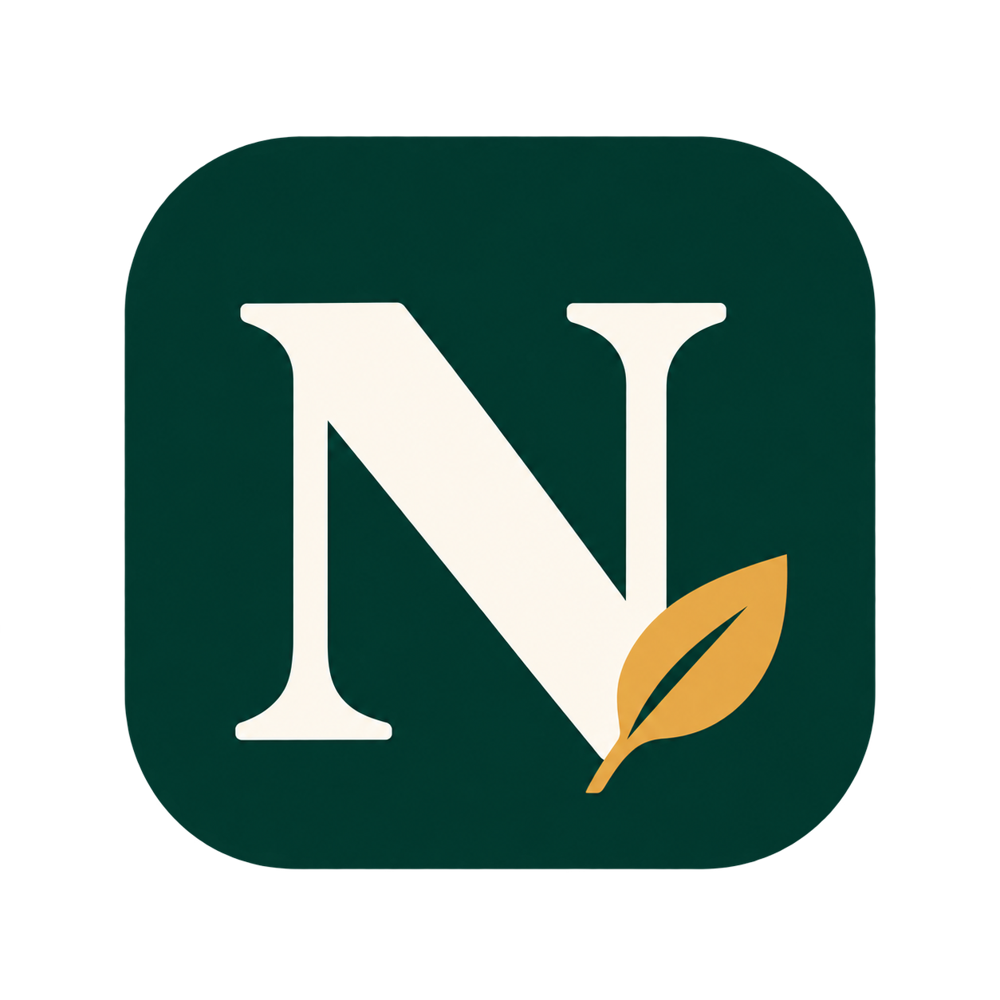

# askNobby

askNobby applies for a person who is looking for work, and lets a recruiter post a role, from the chat they already use. Stratustech Ltd publishes it. The chat is the interface. This folder is the plugin that ChatGPT, Codex, and Claude install.

## Skills

| Skill | When it is used |
| --- | --- |
| get-started | The person has just connected, or has not said whether they are looking for work or hiring |
| find-work | Create a search, including a second search |
| manage-search | Show, change, or delete a saved search |
| manage-applications | Show what was submitted, preview matches, or apply to one reference |
| post-a-role | Create an organisation and post a new role |
| manage-roles | Show or change a posted role, or see who applied |
| manage-organisation | Update the organisation, invites, and member scope |

A company email can look for work or hire. The connection keeps the first capacity it is used for. A hiring connection cannot start a search. A job-search connection cannot start an organisation. The other capacity needs another inbox.

## Use it

Connect the askNobby server, then tell the assistant you are looking for work or that you are hiring.

Connecting the assistant signs you in. If you are looking for work, it then reads your CV, asks for your LinkedIn URL, the titles you want, the work you want to spend your time doing, and your limits for location, engagement, and pay. A day rate stays separate from an annual salary. You can keep two searches. The server runs the default search once a day, for a period you choose of up to 30 days, and applies when the match is at least 90 percent. Ask the chat which roles were submitted. You can ask for a one-time search instead. That shows the top five matches and applies only to the references you choose.

If you are hiring, the assistant asks for your organisation, the registered business name, the website, a phone number, and the company number when you have one. People who share a company email domain share one organisation. It then asks for a complete job definition before it posts. A thin role is refused. You get a short reference, such as NBY-7K2Q, and you share that reference unchanged.

## Data

The plugin files do not contain a key or a token. Connecting opens the askNobby sign-in page. We email a link, you press Confirm, and the assistant keeps its own access token.

The server at https://www.asknobby.com/api/mcp receives what the assistant sends for the tool you asked for. For a candidate, that includes the CV text, the original CV file when the assistant has it, the aim, titles, LinkedIn URL, location, engagement, and pay limits. For a recruiter, that includes the organisation details and the role text. When a role is scored, we send the aim, the titles, the CV text, and the work description to Jev at Wrangle. We do not send pay, place, or engagement to Jev. Those limits are checked in our own code. A submitted application shows the recruiting organisation the elevator pitch, the CV, and the match score.

The privacy policy is at https://www.asknobby.com/privacy and the terms are at https://www.asknobby.com/terms.
